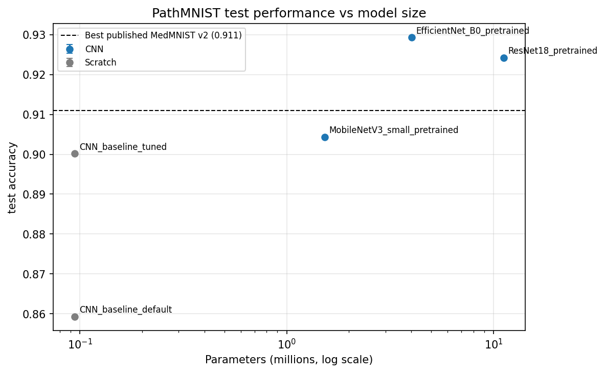
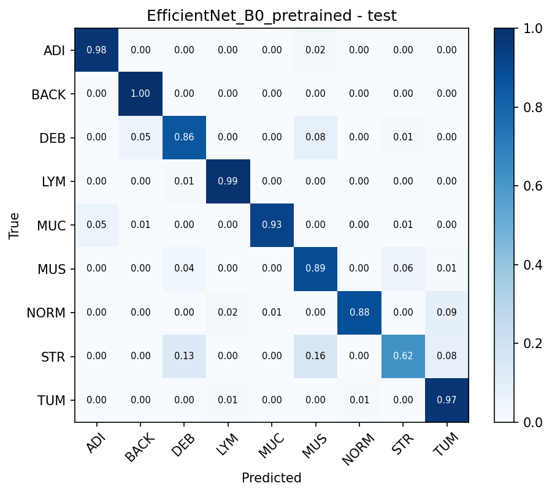
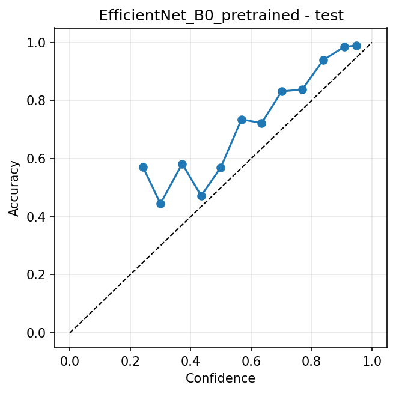

# capstone_benchmark - results

Seeds per model: mean ± SD over seeds; 95% CI = patch-level bootstrap (1000 resamples) for the first seed. Model selection used validation data only.

| ID | Family | Params (M) | Input | Test accuracy | 95% CI | Macro F1 | Macro AUC | Balanced acc | ECE | TUM recall | Train (min) | Infer (ms/img) |
|---|---|---|---|---|---|---|---|---|---|---|---|---|
| CNN_baseline_default | Scratch | 0.09 | 28 | 0.8593 | 0.852-0.867 | 0.7978 | 0.9634 | 0.7955 | 0.050 | 0.959 | 21.7 | 0.306 |
| CNN_baseline_tuned | Scratch | 0.09 | 28 | 0.9001 | 0.894-0.907 | 0.8651 | 0.9867 | 0.8703 | 0.031 | 0.950 | 153.8 | 4.440 |
| MobileNetV3_small_pretrained | CNN | 1.53 | 64 | 0.9043 | 0.898-0.911 | 0.8738 | 0.9851 | 0.8736 | 0.063 | 0.951 | 12.4 | 0.624 |
| EfficientNet_B0_pretrained | CNN | 4.02 | 64 | 0.9292 | 0.923-0.936 | 0.9029 | 0.9914 | 0.9018 | 0.077 | 0.974 | 49.3 | 2.649 |
| ResNet18_pretrained | CNN | 11.18 | 64 | 0.9242 | 0.918-0.931 | 0.8944 | 0.9901 | 0.8951 | 0.095 | 0.964 | 46.6 | 4.065 |

Published MedMNIST v2 PathMNIST results (Yang et al. 2023): ResNet-18 (28): acc 0.907, AUC 0.983; ResNet-18 (224): acc 0.909, AUC 0.989; ResNet-50 (28): acc 0.911, AUC 0.99; ResNet-50 (224): acc 0.892, AUC 0.989

**PO1 / H1** - best model by test macro F1: **EfficientNet_B0_pretrained** (accuracy 0.9292, macro AUC 0.9914). Target accuracy ≥ 0.911 and AUC ≥ 0.99: **met** (point estimates; see CIs).

 

## Per-class test F1 (first seed)

|                              |   ADI |   BACK |   DEB |   LYM |   MUC |   MUS |   NORM |   STR |   TUM |
|:-----------------------------|------:|-------:|------:|------:|------:|------:|-------:|------:|------:|
| CNN_baseline_default         | 0.948 |  0.925 | 0.393 | 0.941 | 0.896 | 0.702 |  0.902 | 0.548 | 0.926 |
| CNN_baseline_tuned           | 0.942 |  0.96  | 0.708 | 0.964 | 0.901 | 0.839 |  0.923 | 0.616 | 0.934 |
| MobileNetV3_small_pretrained | 0.965 |  0.948 | 0.821 | 0.963 | 0.938 | 0.814 |  0.881 | 0.624 | 0.91  |
| EfficientNet_B0_pretrained   | 0.968 |  0.985 | 0.808 | 0.971 | 0.958 | 0.847 |  0.924 | 0.721 | 0.943 |
| ResNet18_pretrained          | 0.978 |  0.983 | 0.831 | 0.967 | 0.957 | 0.845 |  0.913 | 0.645 | 0.929 |

## Paired comparisons vs CNN_baseline_tuned (same seed, test set)

Paired bootstrap of the macro-F1 difference and McNemar's test; p-values Holm-adjusted.

| id                           | vs                 |   seed |   delta_macro_f1 | delta_ci95         |   p_bootstrap |   p_mcnemar |   only_model_correct |   only_reference_correct |   p_bootstrap_holm |   p_mcnemar_holm | significant_0.05   |
|:-----------------------------|:-------------------|-------:|-----------------:|:-------------------|--------------:|------------:|---------------------:|-------------------------:|-------------------:|-----------------:|:-------------------|
| CNN_baseline_default         | CNN_baseline_tuned |     42 |          -0.0673 | -0.0761 to -0.0578 |         0.001 |      0      |                  194 |                      487 |              0.004 |           0      | True               |
| MobileNetV3_small_pretrained | CNN_baseline_tuned |     42 |           0.0086 | -0.0003 to +0.0180 |         0.068 |      0.2434 |                  324 |                      294 |              0.068 |           0.2434 | False              |
| EfficientNet_B0_pretrained   | CNN_baseline_tuned |     42 |           0.0377 | +0.0291 to +0.0471 |         0.001 |      0      |                  410 |                      201 |              0.004 |           0      | True               |
| ResNet18_pretrained          | CNN_baseline_tuned |     42 |           0.0292 | +0.0204 to +0.0384 |         0.001 |      0      |                  378 |                      205 |              0.004 |           0      | True               |
